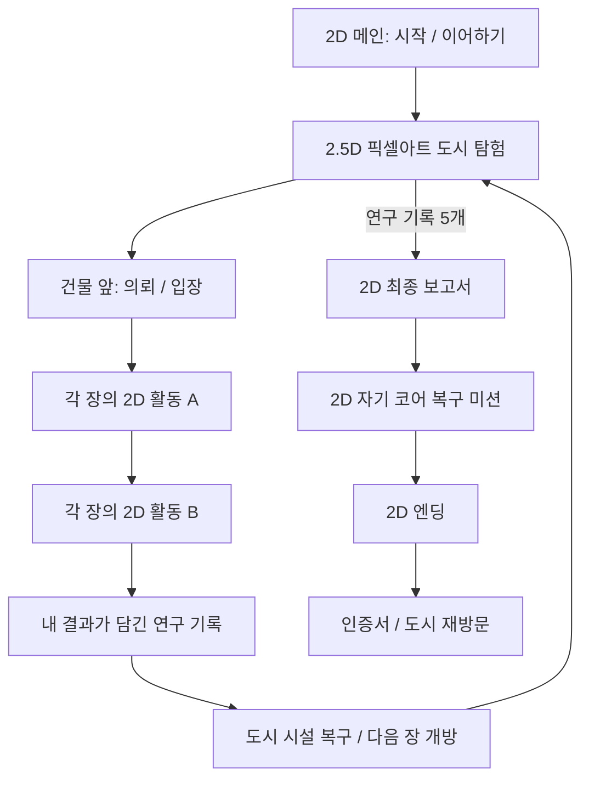

# PRD — 밀고 당기는 도시 MVP

버전: 1.0 · 2026-09-23 · 구현 전 설계

## 1. 제품 목표

학생이 자석의 성질을 직접 조사하고 실험한 결과로 도시의 고장 난 시설을 복구한다. 화면을 넘긴 횟수보다 **조건을 바꾸고 결과를 근거로 해결한 경험**을 남긴다.

- 대상: 초등 4학년, 개인 또는 두 학생이 한 태블릿을 함께 사용하는 수업.
- 환경: 태블릿 가로 화면 우선, 전자칠판·데스크톱 대응.
- 학습 흐름: 생활 속 역할 발견 → 재료와 거리 비교 → 극 추리 → 원격 제어 → 발명·검증.
- 시간: 장별 5~8분, 도입·최종 활동 포함 35~50분을 초기 설계 목표로 삼는다. 실제 학생 관찰 후 조정하며 제한시간은 두지 않는다.
- 수업 중 중단하고 다음 시간에 같은 기기에서 이어갈 수 있다.

## 2. MVP 범위

### P0 — 전체 MVP에 반드시 포함

| 영역 | 제공 내용 |
|---|---|
| 메인 | 기존 로고, 시작·이어하기, 소리 설정 |
| 도시 | 2.5D 픽셀아트 도시 1개, 이동 캐릭터, 5개 시설과 중앙 코어, NPC 대화·입장 |
| 활동 | 5장·10개 2D 활동, 실험 결과에 따른 피드백과 다시 시도 |
| 진행 | 순차 개방, 완료한 장 재방문, 다섯 연구 기록, 시설 복구 상태 |
| 최종 | 실제 결과가 담긴 보고서, 코어 조작 미션, 20~25초 2D 엔딩, 인증서·인쇄 |
| 저장 | 단일 기기 진행, 활동별 체크포인트, 저장 실패 안내 |
| 입력 | 터치·마우스, 도시 키보드 이동, 드래그 대체 선택·배치 조작 |
| 피드백 | 한 줄 상황 안내, 행동 힌트, 실험 결과·비교 기록 |
| 음향 | 켜기·끄기, 기본 조작·성공·도시 복구 효과음. 소리 없이도 완료 가능 |

### 후속 범위

계정·교사 대시보드·학급 통계·멀티플레이·서버 저장·Science World 실제 허브 연동·설치형 PWA와 완전 오프라인·음성 더빙·AI 생성 영상·자유 부품 물리 샌드박스·추가 퀘스트·행동 기반 탐구 성향 판정은 포함하지 않는다. 과거의 탐구 스타일 분류 대신 MVP 인증서에는 실제 완료한 탐구 내용을 기록한다.

3D 회전, 전자석, 자기장 선 시각화, 수치 물리 공식, 전투, 체력, 상점, 별 수집은 이번 학습 흐름에 넣지 않는다.

## 3. 플레이 흐름

- 활동 중에는 언제든 도시로 돌아갈 수 있다. 진행은 최근 확정한 조작까지 저장한다.
- 이어하기는 진행 중 활동의 체크포인트를 우선 열고, 없으면 도시에서 시작한다.
- 완료한 장은 재실험할 수 있다. 완료 기록과 복구 상태는 취소되지 않는다.
- 재실험은 별도 연습 기록으로 저장하며 최초 인증에 사용한 증거를 덮어쓰지 않는다.

## 4. 도시와 이야기

도시 장치들이 멈춰 생활과 운반이 불편해졌다. 당이는 원인을 단정하지 않고 학생에게 조사와 복구를 의뢰한다. 밀이와 함께 실험하며 다섯 연구 기록을 모으고, 마지막에 중앙 코어를 직접 복구한다.

코어와 도시의 연결 연출은 이야기 장치다. 자석이 전기를 무한히 만들거나 모든 도시 시설을 실제로 원격 제어한다는 설명은 하지 않는다.

### 도시에서 할 수 있는 일

1. 길을 누르거나 방향키/WASD로 밀이를 이동한다.
2. 시설을 누르면 입구까지 걸어간다. 도착 후 의뢰를 보고 입장한다.
3. 당이에게 말을 걸어 현재 목적과 연구 기록을 확인한다.
4. 아직 열리지 않은 시설도 가까이 가서 이름과 필요한 이전 미션을 알 수 있다.
5. 완료한 시설의 변화와 학생의 발명 전시를 확인한다.

큰 월드 탐색·숨은 입구·길찾기 퍼즐은 넣지 않는다. 첫 진입에서 첫 시설까지 안내하고, 자유 이동 자체가 학습 진입을 방해하지 않게 한다.

### NPC

- **밀이:** 현장 실험 파트너이자 도시 이동 캐릭터. 조작 위치와 다음 실험 행동을 알려 준다.
- **당이:** 광장의 연구 기록 담당. 의뢰, 비교 질문, 연구 기록과 최종 보고를 담당한다.
- 대화는 한 번에 두 줄 이내, 다음·닫기 제공. 중요한 조건은 대화를 닫아도 미션 안내에서 다시 볼 수 있다.
- 캐릭터는 실제 제공 시트를 기준으로 한다. 자세한 형태 기준은 DESIGN 문서 참조.

## 5. 장별 활동 계약

각 활동은 **상황 → 예상 또는 계획 → 조작 → 관찰 → 필요하면 수정 → 기록**을 따른다. 정답 선택만으로 완료할 수 없다. 힌트를 써도 불이익이 없다.

### 1장 — 장치 속 힘의 단서 / 생활 자석 조사국

상황: 보관함 덮개와 책갈피가 제 역할을 하지 못한다.

**S01 도시 물건 해부실**

- 대상: 자석식 보관함과 자석 책갈피 두 종류.
- 조작: 열기·닫기, 확대, 2D 내부 레이어 보기, 자석 예상 위치 표시.
- 예상 위치는 오답이어도 먼저 기록하고 관찰 후 고칠 수 있다. 추측 횟수를 제한하지 않는다.
- 피드백: 가까워지는 두 면과 내부 자석의 위치를 연결해 보여 준다.
- 완료: 두 장치 모두 사용해 보고, 내부를 관찰하고, 자석 위치를 확인한다.
- 기록: 장치별 최초 예상 위치, 확인 위치, 관찰 완료 여부.
- 다음 활동은 조사한 같은 두 장치를 사용한다.

**S02 자석 넣기·빼기 비교실**

- 조작: 자석 부품을 넣고 빼면서 같은 장치를 작동시킨다. 비교 재생과 되돌리기를 제공한다.
- 피드백: 자석이 있을 때의 고정과 없을 때의 벌어짐·이탈을 같은 조건에서 보여 준다.
- 완료: 두 장치에서 자석 있음·없음 양쪽을 시험하고, 관찰과 맞는 역할을 연결한다.
- 잘못 연결하면 해당 조건을 재생하고 다시 선택한다. 시험 없이 역할만 선택할 수 없다.
- 증거 E01: **생활 자석 조사 기록** — 두 장치의 위치·역할·비교 결과.
- 도시 변화: 조사국 전시 보관함의 덮개가 정상적으로 닫힌다. 복구율 20%.

### 2장 — 붙는 물체의 규칙 / 힘 실험 연구소

상황: 재료 분류 장치가 물체를 잘못 분류한다.

**S03 재료 반응 실험대**

- 대상 6개: 철 클립, 철못, 알루미늄 조각, 나무 조각, 플라스틱 블록, 고무 지우개. 재료 이름을 표시한다.
- 조작: 반응을 예상한 뒤 자석을 가까이 움직인다. 붙는 물체는 자석 방향으로 움직이며 기록이 생긴다.
- 완료: 서로 다른 6개 모두 실험하고 철과 알루미늄의 차이를 확인한다.
- 예상이 틀려도 실험 결과를 관찰하면 기록한다. 예상을 정답으로 고쳐야만 통과시키지 않는다.
- 기록: 재료, 예상, 관찰 결과. 금속 전체가 붙는다는 결론을 유도하지 않는다.

**S04 거리와 힘 실험대**

- 대상: 동일한 자석과 철 클립. 가까움·중간·멀어짐 조건을 바꾸어 본다.
- 조작: 거리 슬라이더, 얇은 종이판 넣기·빼기, 시험, 비교 기록 보기.
- 완료: 판이 없는 상태에서 가까운 거리와 먼 거리를 비교하고, 동일한 가까운 거리에서 판 유무를 비교한다. 최소 세 조건의 기록이 필요하다.
- 판을 넣을 때 자석과 클립의 거리를 자동으로 늘리지 않는다. 비교 중 어떤 조건을 고정했는지 보여 준다.
- 피드백: 가까울 때 이동이 크고, 멀어질수록 약해지며, 이 실험의 얇은 종이판을 사이에 두어도 반응한다.
- 증거 E02: **힘 반응 실험 기록** — 6개 재료 표와 조건 비교 세트.
- 도시 변화: 분류 컨베이어가 철 물체를 분리하며 움직인다. 복구율 40%.

### 3장 — 뒤섞인 극을 복원하라 / 극성 복원 센터

상황: 자석의 극 표시가 사라지고 고리 장치가 붙어 버렸다.

**S05 극 추리 실험실**

- 대상: N/S 표시가 있는 기준 자석과 색으로 답을 알 수 없는 미지 자석 4개.
- 조작: 기준 자석을 뒤집고 가까이 대어 반응을 본 다음 미지 자석의 양 끝에 N/S를 배치한다.
- 완료: 각각 N극과 S극을 향한 두 비교 실험을 거쳐 네 자석의 양 끝을 올바르게 표시한다.
- 피드백: 같은 극이면 밀리고 다른 극이면 당겨진다. 오류 시 관찰 기록과 선택한 표시를 함께 보여 준다.
- 기록: 미지 자석별 기준 극, 반응, 최종 표시. 난수로 정한 실제 극은 재접속해도 바뀌지 않는다.

**S06 고리자석 장치**

- 대상: 비자성 지지 막대에 놓인 고리 3개. 바닥 고리는 고정하고 위 두 개를 뒤집는다.
- 조작: 고리 선택·뒤집기·시험. 선택한 고리의 위·아래 극을 표시한다.
- 피드백: 마주 보는 면이 같은 극이면 간격이 생기고 다른 극이면 붙는다. 지지 막대와 받침은 계속 보인다.
- 완료: 두 경계 모두 간격이 생기는 배열을 시험하고 그 이유를 관찰과 연결한다.
- 증거 E03: **극성 판별 기록** — 미지 자석 판별과 고리 배열.
- 도시 변화: 센터 고리 장치의 간격과 표시등이 복구된다. 복구율 60%.

### 4장 — 손대지 않는 제어 작전 / 원격 제어 구역

상황: 수조 청소 도구와 운반 카트가 멈췄다.

**S07 아쿠아 청소 구조실**

- 정면 2D 수조. 외부 자석과 내부의 자석이 달린 청소 패드를 구분해 표시한다.
- 조작: 수조 밖 자석만 움직인다. 내부 패드를 손으로 직접 이동할 수 없다.
- 피드백: 자석을 너무 빨리 움직여 거리가 벌어지면 연결이 풀리고, 다시 가까이 가면 연결된다.
- 완료: 강조된 오염 구역의 85% 이상을 청소한다. 되돌아가 다시 청소할 수 있고 시간·실패 횟수 제한은 없다.
- 기록: 실제 청소율과 연결이 풀린 횟수. 기록은 설명 자료이며 감점에 사용하지 않는다.

**S08 무접촉 카트 제어실**

- 위에서 본 평면 2D 레일, 세 구간. 아이소메트릭 시점을 적용하지 않는다.
- 구간 1은 앞에서 끌기, 구간 2는 뒤에서 밀기, 구간 3은 사용 가능한 앞·뒤 위치 중 선택해 도착한다.
- 조작: 외부 자석을 레일 주변 조작 구역에 배치하고 극·거리를 조절한다. 카트 직접 드래그는 불가하다.
- 피드백: 카트에 달린 자석과의 관계에 따라 전진·후진·정지하고 장애물 앞에서 멈춘다.
- 완료: 밀기와 끌기를 실제로 사용하여 세 구간을 통과한다. 마지막 구간은 복수 해법을 허용한다.
- 증거 E04: **원격 제어 운용 기록** — 청소 결과와 세 구간의 제어 방식.
- 도시 변화: 수조가 맑아지고 운반 카트가 왕복한다. 복구율 80%.

### 5장 — 도시를 위한 자석 발명 / 시민 발명 공방

상황: 시민의 생활 문제를 해결할 장치를 만들고 검증한다.

**S09 발명 설계실**

- 문제 A: 흔들려도 덮개가 쉽게 열리지 않는 보관함.
- 문제 B: 손이 닿지 않는 투명 칸 안의 철제 부품을 밖에서 움직이는 도구.
- 두 문제 중 하나를 골라 완성하면 된다. 문제를 바꾸면 초안은 문제별로 보관한다.
- 공통 조작: 2D 부품 배치·방향 변경·자석 뒤집기·되돌리기. 한 설계의 부품은 최대 6개.
- A는 자석+철판 또는 자석+자석 방식과 좌우 잠금 위치를 선택할 수 있다.
- B는 외부 자석 위치·얇은 비자성 판·이동 경로를 조합한다. 대상은 철제 부품임을 명시한다.
- 정확한 좌표 한 곳을 맞히는 퍼즐로 만들지 않는다. 범위와 부품 간 관계로 작동을 판정한다.
- 완료: 필요한 부품이 배치되어 시험 가능한 상태. 작동 성공은 아직 요구하지 않는다.

**S10 작동 시험실**

- S09의 선택·배치·극·거리를 그대로 가져와 시험한다. 미리 정해진 성공 영상을 무조건 재생하지 않는다.
- A는 닫기·가벼운 흔들기에서 잠금이 유지되는지, B는 외부 자석 조작으로 철제 부품이 목표 지점까지 이동하는지 시험한다.
- 실패 시 관찰된 원인만 안내한다. 예: 마주 보는 극이 같음, 잠금 위치가 어긋남, 거리가 멂.
- 수정하기는 원래 설계와 배치를 유지한 채 S09로 돌아간다.
- 완료: 한 문제의 작동 시험 성공 + 작동을 만든 자석·대상 관계를 짚어 설명한다.
- 첫 설계가 성공하면 바로 완료할 수 있다. 재시험 횟수를 채우도록 강요하지 않는다.
- 증거 E05: **발명 장치 검증서** — 문제, 설계 그림, 실제 시험 결과, 성공 이유.
- 도시 변화: 공방 앞 전시대에 학생이 만든 장치를 전시한다. 복구율 95%.

## 6. 증거·보고·마지막 미션

### 연구 기록

각 장의 두 활동을 모두 완료한 뒤 실제 실험 데이터로 한 장의 기록을 만든다. 제목만 다른 수집 카드로 대체하지 않는다. 연구 가방에서 언제든 열 수 있다.

| ID | 기록 | 보고서에 보여 줄 실제 결과 |
|---|---|---|
| E01 | 생활 자석 조사 기록 | 조사한 두 장치의 자석 위치와 역할 |
| E02 | 힘 반응 실험 기록 | 재료별 반응과 거리·종이판 비교 |
| E03 | 극성 판별 기록 | 판별한 극과 마지막 고리 배열 |
| E04 | 원격 제어 운용 기록 | 청소율, 카트 구간별 밀기·끌기 |
| E05 | 발명 장치 검증서 | 선택 문제, 실제 배치, 시험 결과와 이유 |

기록 5개가 모이면 광장의 당이와 코어 입구가 최종 보고를 안내한다. 보고서는 다섯 결과를 차례로 보여 주며 빠르게 넘겨도 증거를 잃지 않는다.

### 최종 미션

정면 2D 코어 패널에서 다음을 직접 수행한다.

1. 서로 당겨 잠겨야 하는 두 자석의 마주 보는 극을 조절한다.
2. 지지 막대 위 고리 한 개를 뒤집어 필요한 간격을 만든다.
3. 철제 고정판을 자석에 가까이 배치한다.
4. 세 조건이 맞으면 가동 손잡이를 밀어 올린다. 키보드·탭 대체 조작도 제공한다.

조건이 틀리면 결합하지 않음·붙어 버림·판이 닿지 않음으로 드러나고 현재 배치에서 수정한다. 세 조건을 만족한 실제 조작 이후에만 복구율 100%와 완료 상태를 저장한다.

### 엔딩과 인증서

- 0~4초: 코어 작동.
- 4~14초: 복구된 다섯 구역의 2D 장면을 차례로 보여 준다.
- 14~21초: 학생의 발명과 밀이·당이의 반응.
- 21~25초: 도시 복구 완료와 인증서 전환.
- 건너뛰기·다시 보기 제공. 건너뛰어도 완료 기록과 인증서를 얻는다.
- 인증서는 닉네임 선택 입력, 완료 날짜, 다섯 탐구 내용, 발명 결과를 표시한다. 이름 입력은 필수가 아니다.
- 브라우저 인쇄로 출력하거나 사용자의 인쇄 기능으로 PDF 저장할 수 있게 인쇄 레이아웃을 제공한다.

## 7. 진행·실패·저장

- 1장만 처음 개방한다. E01~E04가 각각 다음 장을 연다. E05까지 모이면 최종 보고가 열린다.
- 복구율: 0 / 20 / 40 / 60 / 80 / 95 / 100. UI·저장·인증서 모두 동일한 파생 규칙을 쓴다.
- 실패로 시설 복구나 이미 획득한 증거를 잃지 않는다.
- 다시 시작은 현재 활동만 초기화한다. 전체 새 시작은 기존 진행을 지운다는 안내 후 별도 확인한다.
- 저장 완료 전에는 저장되었다고 표시하지 않는다. 저장 불가 시 현재 플레이는 계속하고 다음 실행에 남지 않을 수 있음을 알린다.
- 활동별 확정 조작과 화면 전환 시 저장한다. 마지막 저장 이후 끊긴 드래그는 이전 확정 위치로 복원한다.

## 8. 화면·접근성 기준

- 목표 가로 화면: 1280×800, 1024×768, 1366×768, 전자칠판 1920×1080. 세로 화면은 회전 안내와 안전한 일시정지를 제공한다.
- 실험은 정면·측면·평면 2D이며 화면의 55~65%를 우선 확보한다.
- 핵심 문장은 두 줄 이내. 기록과 긴 설명은 접었다 펼친다.
- 터치 영역은 실제 표시 크기 48×48 CSS px 이상, 주요 버튼은 높이 64px 목표.
- 빨강·파랑 외에 N/S 글자와 움직임으로 극을 구분한다.
- 모션 줄이기·소리 끄기, 키보드 포커스, 이름 있는 버튼을 제공한다.
- 잘못 누른 상태는 되돌리기·위치 초기화로 회복한다. 타이밍이나 손의 정밀도를 통과 기준으로 삼지 않는다.

## 9. 완료 판정

1. 새 시작부터 5장·10활동·코어·인증서까지 가짜 완료 버튼 없이 진행된다.
2. 실험하지 않은 활동은 정답만 클릭해도 완료되지 않는다.
3. 다섯 기록이 실제 실험 데이터와 일치하고 시설 복구 상태도 일치한다.
4. 화면 새로고침·활동 중 도시 복귀·재실험 후에도 진행과 설계가 복원된다.
5. 첫 발명 시험 성공, 실패 후 수정 성공 두 경로가 모두 정상이다.
6. 태블릿 터치와 데스크톱 입력으로 같은 목표를 달성할 수 있다.
7. 픽셀아트와 2.5D 시점은 도시 탐험에만 쓰이고 나머지는 샘플 기반 2D로 통일된다.
8. 글자·버튼이 배경 이미지에 합쳐져 있지 않으며 주요 UI에 잘림·겹침이 없다.
9. 성능·저장·입력 검증 결과를 실제 실행 기록으로 남긴다. 설계만으로 통과 처리하지 않는다.

## 10. 근거

기존 통합 설계서 v2와 ZIP의 PRD/TRD, 현재 사용자의 도시 탐험·2D 화면 지시를 종합했다. 교육과정은 제공 문서의 [4과09-01]~[4과09-03]을 기준으로 하되 공식 원문 대조는 남아 있다. 구현·학생 사용성 검증·교육 전문가 검토는 아직 수행하지 않았다.
